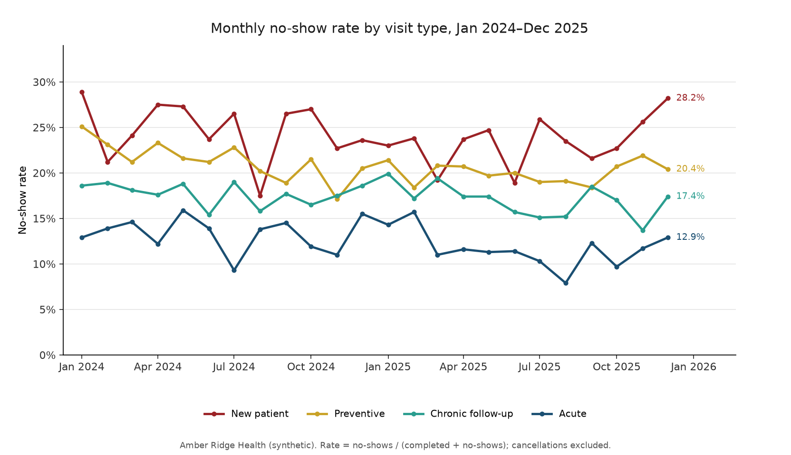

# Day 001 — Monthly clinic no-show rate by visit type

**Date:** 2026-11-25 (America/New_York) · **Skills:** SQL (CTEs, window functions), Python, Matplotlib

[query.sql](query.sql) · [analysis notebook](analysis.ipynb) · [chart](chart.png)

## Business question

For a six-clinic primary care network, **how has the monthly no-show rate changed over the last two years, and which visit types (and modalities) drive it?** Clinic managers use this number in a monthly KPI huddle, so the definition has to be stable and the action has to be specific.

**Definition:** no-show rate = no-shows ÷ (completed + no-shows). Cancellations are excluded, because a cancelled slot can often be refilled.

## Approach

1. Use the shared synthetic appointment table in [`shared/clinic.db`](../../shared/clinic.db) (January 2024–December 2025, Amber Ridge Health — fictional).
2. Run the named queries in [`query.sql`](query.sql): overall rate, breakdowns by visit type, modality, clinic and year, plus a monthly trend with month-over-month change and a 3-month moving average (`LAG` / window `AVG`).
3. Plot the monthly rate by visit type and write the takeaway a clinic manager can act on.

## Results

From 49,538 scheduled visits, **4,448** were cancelled and set aside. Of the remaining **45,090** eligible visits, **7,898** were no-shows: a network rate of **17.5%**.

The rate improved from **18.1%** in 2024 to **17.0%** in 2025 (1.1 percentage points). The 3-month moving average fell from **18.8%** in March 2024 to **16.9%** in December 2025. August 2025 was the low point at **15.1%**; December still shows a seasonal bump (**18.0%** in 2025, **19.4%** in January 2024).

| Visit type | Eligible visits | No-shows | No-show rate | Avg. lead time | Share booked >14 days |
|---|---:|---:|---:|---:|---:|
| New patient | 4,521 | 1,088 | **24.1%** | 16.2 days | 54.0% |
| Preventive | 8,923 | 1,853 | **20.8%** | 12.4 days | 36.3% |
| Chronic follow-up | 20,458 | 3,558 | **17.4%** | 11.9 days | 34.2% |
| Acute | 11,188 | 1,399 | **12.5%** | 3.9 days | 6.9% |

New-patient visits no-show at nearly twice the acute rate, and they are the ones booked furthest out.

Modality is just as sharp, and it matches a hybrid-care operations story:

| Modality | Eligible visits | No-show rate |
|---|---:|---:|
| In person | 32,708 | **20.2%** |
| Video | 8,515 | **11.1%** |
| Audio-only | 3,867 | **8.8%** |

Virtual visits no-show at roughly half the in-person rate. Among completed visits, the virtual share rose from **27.9%** in 2024 to **31.8%** in 2025.

One clinic stands out. **Brookfield Medical Group (C05)** has a **25.7%** no-show rate versus a **15.9%** average at the other five clinics — 9.8 percentage points higher.

## Takeaway for a clinic manager

1. **Start outreach with new-patient and preventive visits.** They have the highest no-show rates and the longest booking windows. Shorten the default booking horizon where you can, and put reminder calls or texts on anything booked more than 14 days out.
2. **Offer a virtual slot first for routine chronic follow-up** when an in-person slot is far out. In-person chronic follow-ups no-show at 21.1%, versus 10.8% on video.
3. **Put Brookfield (C05) first on the list.** A 25.7% no-show rate against a 15.9% peer average is an operations problem, not noise. Review its template, reminder workflow, and in-person lead times before changing anything network-wide.

The 1.1-point improvement from 2024 to 2025 is real but modest. Most of the remaining opportunity is concentrated in in-person new-patient and preventive visits, and at one clinic.
