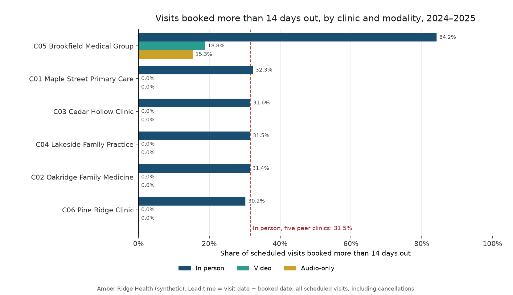

# Day 002 — Share of visits booked more than 14 days out, by clinic and modality

**Date:** 2026-11-26 (America/New_York) · **Skills:** SQL (CASE, joins, `ROW_NUMBER` percentiles, windowed shares), Python, Matplotlib

[query.sql](query.sql) · [analysis notebook](analysis.ipynb) · [chart](chart.png)

## Business question

For a six-clinic primary care network, **how often does a patient have to book more than two weeks ahead, and is that access gap concentrated at particular clinics or in particular visit modalities?** A clinic manager uses this number to decide where to open template capacity and when to steer routine visits to video.

**Definition:** long-lead share = scheduled visits with lead time over 14 days ÷ all scheduled visits. Lead time = visit date − booked date. Completed, no-show, and cancelled visits all count, because the booking window is set at the moment the slot is booked.

## Approach

1. Use `fact_appointment` and `dim_clinic` in the shared synthetic database [`shared/clinic.db`](../../shared/clinic.db) (January 2024–December 2025, Amber Ridge Health — fictional).
2. Check the field first: the stored lead time matches visit date − booked date on every row (0 mismatches, 0 visits booked after the visit date; range 0–47 days).
3. Run the named queries in [`query.sql`](query.sql): network share, by modality (with median and 90th-percentile lead time via `ROW_NUMBER`), by clinic, clinic × modality, Brookfield versus peers by visit type, lead-time bands, by year, and the in-person no-show rate on either side of the 14-day line.
4. Plot clinic × modality and write the takeaway.

## Results

Of **49,538** scheduled visits, **14,909** were booked more than 14 days out: **30.1%** of the network, with an average lead time of **10.5 days**.

The gap is almost entirely an in-person problem:

| Modality | Scheduled visits | Booked >14 days | Share >14 days | Avg. lead | Median | 90th pct |
|---|---:|---:|---:|---:|---:|---:|
| In person | 36,005 | 14,488 | **40.2%** | 12.5 days | 12 days | 23 days |
| Video | 9,289 | 329 | **3.5%** | 5.4 days | 5 days | 11 days |
| Audio-only | 4,244 | 92 | **2.2%** | 5.0 days | 4 days | 9 days |

The in-person share barely moved between years (**40.5%** in 2024, **40.0%** in 2025).

By clinic, one site stands apart:

| Clinic | Scheduled visits | Share >14 days | In person | Video | Audio-only |
|---|---:|---:|---:|---:|---:|
| C05 Brookfield Medical Group | 8,352 | **65.5%** | 84.2% | 18.8% | 15.3% |
| C01 Maple Street Primary Care | 8,775 | 23.4% | 32.3% | 0.0% | 0.0% |
| C04 Lakeside Family Practice | 8,537 | 23.1% | 31.5% | 0.0% | 0.0% |
| C03 Cedar Hollow Clinic | 7,941 | 23.0% | 31.6% | 0.0% | 0.0% |
| C02 Oakridge Family Medicine | 8,309 | 22.9% | 31.4% | 0.0% | 0.0% |
| C06 Pine Ridge Clinic | 7,624 | 22.0% | 30.2% | 0.0% | 0.0% |

At **Brookfield (C05)**, **84.2%** of in-person visits are booked more than 14 days out, versus **31.5%** at the five peer clinics (average in-person lead time **22.9 days** versus **10.4 days**). The pattern holds for every visit type, including acute visits: **49.8%** of Brookfield's in-person acute visits book more than 14 days out, against **0.0%** at peers. Brookfield is also the only clinic where virtual visits ever book that far ahead.

Long waits are not just an access issue. In-person visits booked more than 14 days out no-show at **25.8%**, versus **16.5%** for those booked within 14 days.

## Takeaway for a clinic manager

1. **Treat Brookfield (C05) as a capacity problem, starting with acute access.** Half of its in-person acute visits wait more than two weeks, which peers never do. Review its template for protected same-day and next-day acute slots before anything else; this is also the likely driver of its high no-show rate in [Day 001](../day-001-monthly-no-show-by-visit-type/).
2. **At the other five clinics, use video as the pressure valve.** Their virtual visits never book beyond 14 days, while about 31.5% of in-person visits do. When the next in-person routine follow-up is more than two weeks out, offer a video slot first.
3. **Track long-lead share monthly alongside no-show rate.** In-person visits booked more than 14 days out no-show at 25.8% versus 16.5%, so every long-lead booking that moves inside two weeks (or to video) also protects the schedule.
