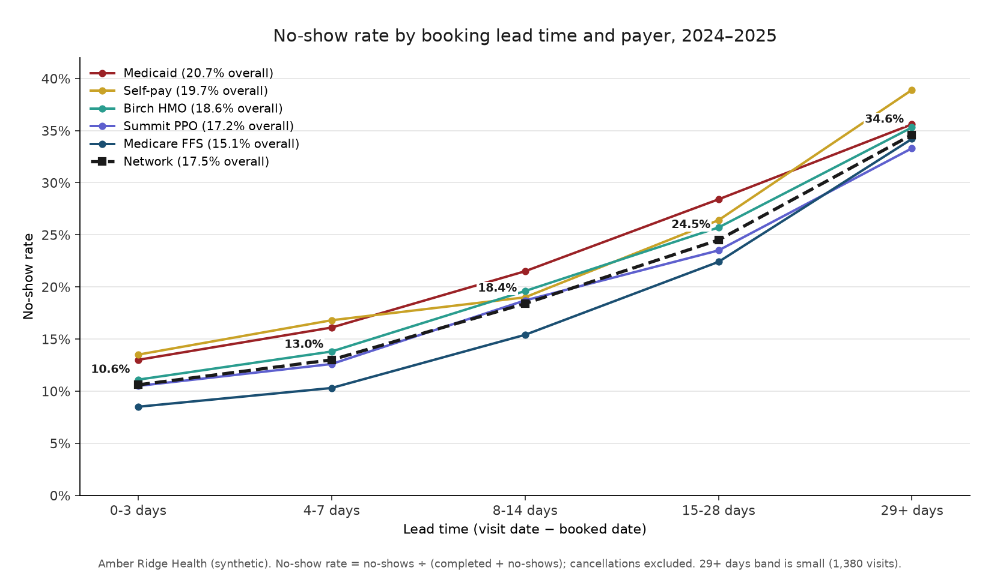

# Day 003 — No-show rate by lead-time band and payer

**Date:** 2026-11-27 (America/New_York) · **Skills:** SQL (CASE bands, joins, window-function shares and `ROW_NUMBER` ranking, indirect standardization), Python, Matplotlib

[query.sql](query.sql) · [analysis notebook](analysis.ipynb) · [chart](chart.png)

## Business question

[Day 002](../day-002-long-lead-bookings-by-clinic-modality/) found that in-person visits booked more than 14 days out no-show far more often. **How steep is that curve across finer lead-time bands, how much do no-show rates differ by payer, and is the payer gap real once lead time is held constant?** A clinic manager uses the answer to decide whether to spend effort on shorter booking windows, on payer-targeted outreach, or both.

**Definition:** no-show rate = no-shows ÷ (completed + no-shows); cancellations are excluded. Lead time = visit date − booked date, in five bands: 0–3, 4–7, 8–14, 15–28, and 29+ days. Payer is the patient's payer on `dim_patient` (one per patient), labelled from `dim_payer`.

## Approach

1. Use `fact_appointment`, `dim_patient`, and `dim_payer` in the shared synthetic database [`shared/clinic.db`](../../shared/clinic.db) (January 2024–December 2025, Amber Ridge Health — fictional).
2. Check the join first: all **49,538** scheduled visits reach a patient and a payer (0 unmatched patients, 0 unmatched payers, 0 duplicate patient rows).
3. Run the named queries in [`query.sql`](query.sql): network rate, rate by lead band (all visits and in person only), rate by payer with each payer's lead-time mix, payer × band, the payer spread inside each band (`ROW_NUMBER`), and observed versus expected no-shows per payer, where expected scores each visit at the network rate for its lead band and modality.
4. Plot payer × band against the network curve and write the takeaway.

## Results

Of **45,090** completed or no-show visits, **7,898** were no-shows: **17.5%**.

**Lead time is the bigger driver.** The no-show rate more than triples from the shortest to the longest band:

| Lead time | Eligible visits | Share of visits | No-shows | No-show rate | In person only |
|---|---:|---:|---:|---:|---:|
| 0–3 days | 10,726 | 23.8% | 1,132 | **10.6%** | 12.5% |
| 4–7 days | 9,488 | 21.0% | 1,231 | **13.0%** | 15.7% |
| 8–14 days | 11,414 | 25.3% | 2,095 | **18.4%** | 19.7% |
| 15–28 days | 12,082 | 26.8% | 2,963 | **24.5%** | 24.7% |
| 29+ days | 1,380 | 3.1% | 477 | **34.6%** | 34.6% |

The in-person column climbs the same way, so the curve is not just virtual visits sitting in the short bands. (The 29+ day band is small and entirely in person.)

**Payer matters, but less, and not because of booking patterns:**

| Payer | Type | Eligible visits | No-shows | No-show rate | Avg. lead | Booked >14 days | Observed ÷ expected |
|---|---|---:|---:|---:|---:|---:|---:|
| Medicaid | medicaid | 7,639 | 1,579 | **20.7%** | 10.5 days | 30.1% | **1.18** |
| Self-pay | self_pay | 2,226 | 439 | **19.7%** | 10.3 days | 28.8% | **1.13** |
| Birch HMO | commercial | 7,382 | 1,371 | **18.6%** | 10.6 days | 30.8% | **1.05** |
| Summit PPO | commercial | 14,695 | 2,530 | **17.2%** | 10.5 days | 29.9% | **0.98** |
| Medicare FFS | medicare | 13,148 | 1,979 | **15.1%** | 10.3 days | 29.3% | **0.86** |

Every payer has nearly the same lead-time mix (average lead 10.3–10.6 days; 28.8%–30.8% booked more than 14 days out), so the 5.6-point gap between Medicaid and Medicare FFS is not explained by how far out their visits are booked. After adjusting for lead band and modality, Medicaid has **1,579** no-shows against **1,340.5** expected (1.18×), and Medicare FFS has **1,979** against **2,296.0** expected (0.86×).

The payer gap shows up inside every band, at about the same size:

| Lead time | Lowest payer | Rate | Highest payer | Rate | Spread |
|---|---|---:|---|---:|---:|
| 0–3 days | Medicare FFS | 8.5% | Self-pay | 13.5% | 5.0 pts |
| 4–7 days | Medicare FFS | 10.3% | Self-pay | 16.8% | 6.5 pts |
| 8–14 days | Medicare FFS | 15.4% | Medicaid | 21.5% | 6.1 pts |
| 15–28 days | Medicare FFS | 22.4% | Medicaid | 28.4% | 6.1 pts |
| 29+ days | Summit PPO | 33.3% | Self-pay | 38.9% | 5.6 pts |

That is a spread of 5.0–6.5 points between payers, against a 24.0-point climb from the shortest to the longest lead band. The worst common cell is **Medicaid visits booked 15–28 days out, at 28.4%** (2,046 visits).

## Takeaway for a clinic manager

1. **Shorten booking windows first; it helps every payer.** Moving a visit from the 15–28 day band into 4–7 days cuts its expected no-show rate from 24.5% to 13.0%, a bigger effect than any payer difference. Pair this with [Day 002](../day-002-long-lead-bookings-by-clinic-modality/): offer video when the next in-person slot is more than two weeks out.
2. **Target outreach where the two risks stack.** Put live reminder calls, transportation help, and confirm-or-release workflows on Medicaid and self-pay patients whose visits are booked more than 14 days out (28.4% and 26.4% no-show at 15–28 days).
3. **Report no-shows by payer as observed ÷ expected, not raw rates.** Because lead-time mix is the same across payers here, the 1.18× for Medicaid is a real engagement gap to track monthly; in a network where payer mix and booking windows differ, the raw rates would mislead.
